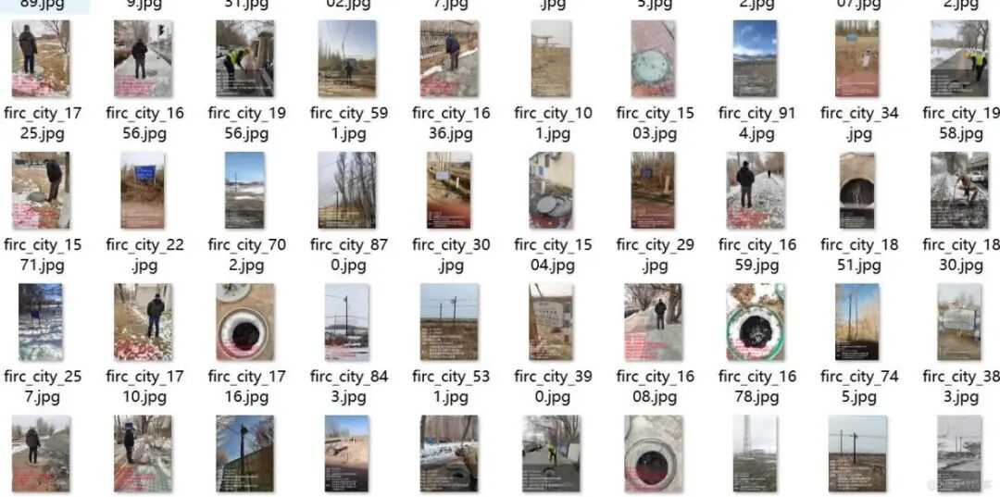
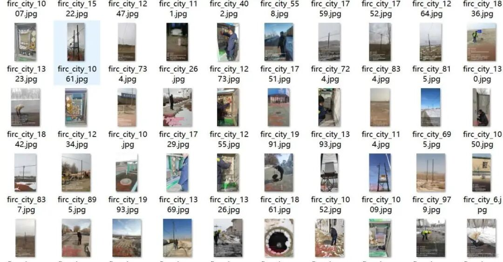
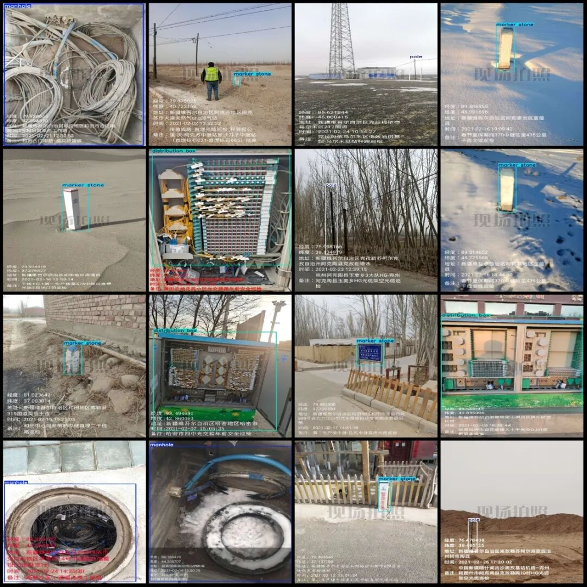

# Smart City Benchmark Data Set for Light Communication Box Personhole Detection in VOC+YOLO format with 2000 images across 4 categories

Dataset format: Pascal VOC format + YOLO format (txt file without split path, only containing jpg images and corresponding VOC format xml files and yolo format txt files)

Number of images (number of jpg files): 2000

Number of annotations (number of xml files): 2000

Number of annotations (number of txt files): 2000

Labeling category count: 4

Label category names (note that the order of yolo format categories does not correspond to this, but is based on the labels folder's classes.txt): ["distribution box", "manhole", "markerstone", "pole"]

Number of boxes labeled in each category:

Distribution box (electric box) Frame count = 521

Manhole (manhole) frame count = 515

Marker stone (marker) frame count = 730

Pole (electric pole) Frames = 623

Total frame count: 2389

Image resolution: Multi-resolution, such as 1080x1440, 1920x2560, etc.

Using labelImg:

Annotation rules: Draw a rectangle around the category.

Important Notice: No

Special : This dataset does not guarantee the accuracy of the trained models or weight files.

Image Preview:

Annotation example:

## Payment

Here is a pay link on Stripe ( https://buy.stripe.com/3cs8yP7sY87d0vu9AB ). Please contact me lonlonago@foxmail.com after funding $89, and I will send you a complete data files , thank you!

